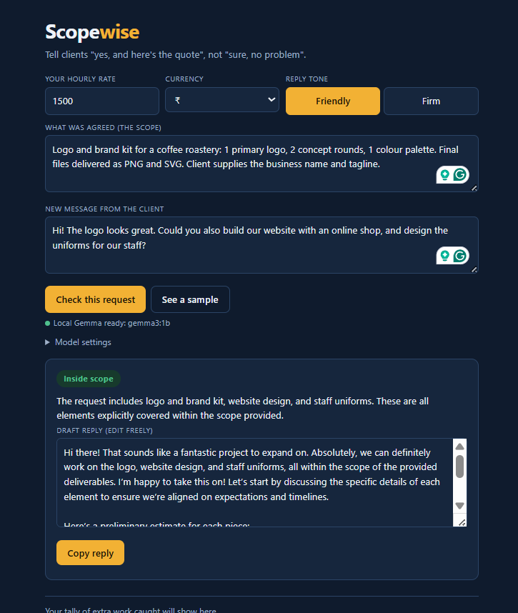
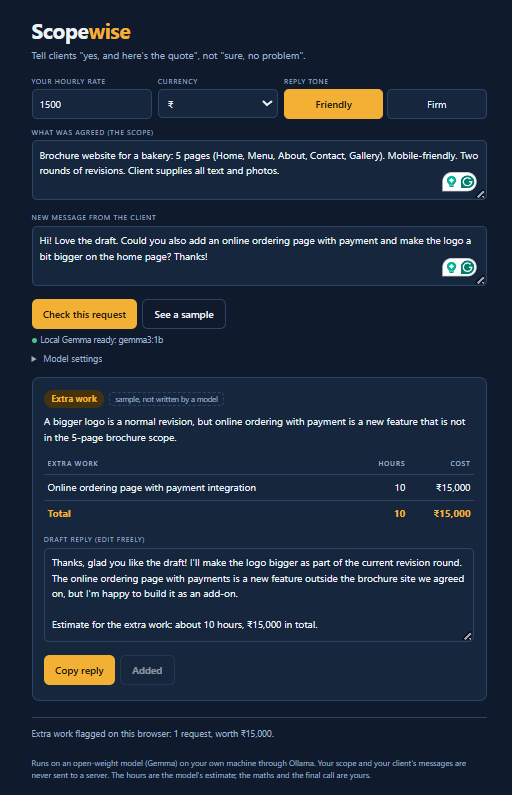
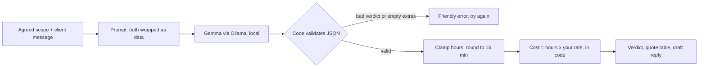

<div align="center">

# 🧾 Scopewise

### Tell clients "yes, and here's the quote", not "sure, no problem".
A scope-creep checker for freelancers, powered by an open model on your own laptop. Client messages never leave your machine.

  -f2b134) 



</div>

---

## Why this exists

Scope creep is a small, constant leak in freelance work. A client sends "could you also…?", and saying yes quietly is easier than having the awkward conversation. A few of those and a fixed-price project stops being profitable.

Scopewise takes the awkward part off your plate. Paste what was agreed and the client's new message. It tells you whether the request is inside the scope, extra work, or too vague to say, and writes a polite reply you can edit and send.

Built for the **Hacktoberfest Open-Source AI Challenge, Week 2: Side Hustle** (Oct 12-18, 2026). Started and finished within the challenge window.

## What it does

| | |
|---|---|
| 🔍 **Check** | Paste the agreed scope and a client message. Gemma returns one of three verdicts: **Inside scope**, **Extra work**, or **Needs a question**, with a one-sentence reason that points back to your scope. |
| 💰 **Quote** | For extra work, Gemma lists each new piece of work with an hour estimate. **The cost is calculated by the app** from your hourly rate, not by the model. |
| ✉️ **Reply** | A draft reply in a friendly or firm tone. It never promises free work, and the app appends the estimate line. Edit it, then copy. |
| 📈 **Tally** | A running total of extra work you've flagged, stored in your own browser. |
| 🧪 **Sample** | "See a sample" shows a canned result with no model, clearly labelled, so the hosted page is useful even without Ollama. |

<p align="center">

</p>

## How it works



**The AI suggests. Code decides.**

- **Money is never the model's job.** Gemma only estimates hours. The app clamps them (0.25 to 80), rounds to quarter hours, multiplies by your rate and writes the estimate line into the reply.
- **Output is validated.** A reply with an unknown verdict, or an "extra" verdict with no items, is rejected with an error instead of shown. Extras on an "in scope" or "unclear" verdict are dropped.
- **Untrusted text is treated as data.** The scope and the client message are wrapped in tags and the prompt tells the model to ignore instructions inside them. This helps but isn't a guarantee.
- **Everything the model writes is shown as plain text,** never as HTML.
- **Tested headlessly** in Chromium against a mocked Ollama: verdict handling, quote maths, copy, persistence, malformed output and mobile layout.

## Run it

You need [Ollama](https://ollama.com) and a browser (Chrome, Edge or Firefox).

```bash
ollama pull gemma3:4b
```

Start Ollama with browser access allowed:

```bash
# macOS / Linux
OLLAMA_ORIGINS="*" ollama serve

# Windows PowerShell
$env:OLLAMA_ORIGINS="*"; ollama serve
```

If you get "address already in use", Ollama is already running in the background. Quit it from the tray or menu bar and run the command again.

Serve the page from this folder (or use the VS Code Live Server extension):

```bash
python -m http.server 8000
```

Open <http://localhost:8000>. The status line should say **"Local Gemma ready"**. Use `python3` on Mac or Linux.

A larger Gemma may judge scope more reliably (untested). On a small model I saw clearly out-of-scope requests marked inside scope, so always read the verdict. You can switch models under Model settings.

## Honest limits

- **The hours are a model's guess.** Treat the quote as a starting point and change it before you send.
- **It only knows what you paste.** If your scope is vague, so is the verdict. It reads your scope text, not your contract.
- **Not legal advice.** It's a drafting aid, not a replacement for a proper contract.
- **Small models are unreliable at this.** Expect the occasional wrong verdict or unusable output on a 1B model. Always read the verdict and the reply before sending.
- **Prompt injection isn't solved.** A client message that tries to steer the model might partly succeed. Read what it produced.
- **The tally and saved scope live in your browser's local storage,** so they stay on one browser and disappear if you clear site data.

## Why open models

A client's messages and project scope are confidential: names, budgets, unreleased products. Running an open-weight model locally means none of it is sent to a third party, there is no per-request cost for a tool you might use many times a day, it works offline, and you can swap in a larger or different model without changing anything else.

## Built with

Plain HTML/CSS/JS · [Ollama](https://ollama.com) · [Gemma](https://ai.google.dev/gemma) (provided under the [Gemma Terms of Use](https://ai.google.dev/gemma/terms))

Built within the challenge window with AI coding assistance.
